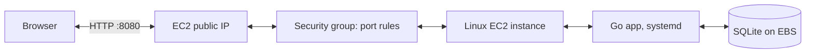

# Mango Cats

A public counter for how many times the cat was fed today. Each click saves a feeding in SQLite, up to 10 per day. The displayed count starts over at midnight Pacific time.

Live app: <http://34.215.113.50:8080> · Health: <http://34.215.113.50:8080/health>

## Run locally

Requires Go 1.27 or newer:

```sh
go mod tidy
go run .
```

`go mod tidy` downloads the SQLite dependency. `go run .` starts the web app. Open <http://localhost:8080>, or check the app and database at <http://localhost:8080/health>. The local database is `cats.db`.

## Deploy to AWS

Requires Go, Terraform, AWS CLI credentials in the `default` profile, SSH, and an AWS account with a default VPC. Check your Free Tier eligibility and set a billing alert first.

```sh
./deployment/initial-deploy.sh
```

The script creates an SSH key at `~/.ssh/mango-cats` if needed, limits SSH to your current public IP, asks Terraform to create one EC2 instance, then builds and deploys the app. Terraform asks you to approve its plan. The script prints the public app and health URLs. The `terraform/` folder defines AWS resources; `deployment/` contains the scripts and systemd service.

For later code updates, run `./deployment/update-app.sh`. If your public IP changes, run `./deployment/initial-deploy.sh` again to update the SSH rule. Keep the instance running until the assignment is reviewed: its public IP changes if you stop and start or replace it, so you would need to send the grader a new link.

## Architecture

[Open the diagram as a file](docs/architecture.mmd).



One EC2 instance keeps this small demo easy to deploy. SQLite avoids a separate database service; systemd starts and restarts the Go process. SSH is limited to your IP, the app runs as an unprivileged user, and the EBS volume is encrypted. Anyone can press the public button. HTTP, authentication, backups, and monitoring would need improvement before real use.

When the review is over, run `./deployment/initial-deploy.sh destroy` to remove the AWS resources. **This deletes the database.** The instance's public IPv4 address can still incur charges while it runs; check your account's Free Tier or credits. Do not commit SSH keys or Terraform state.
